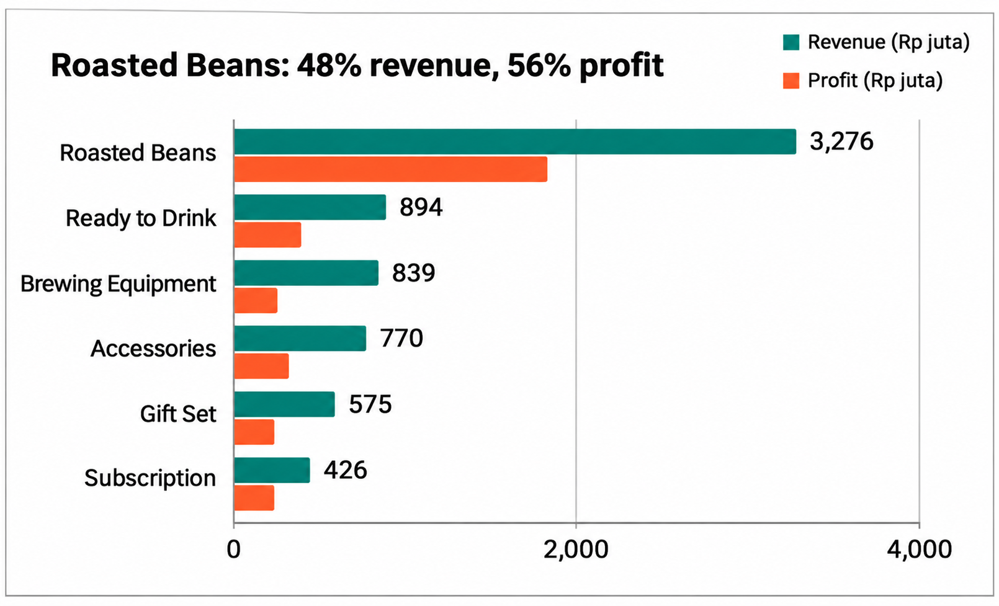
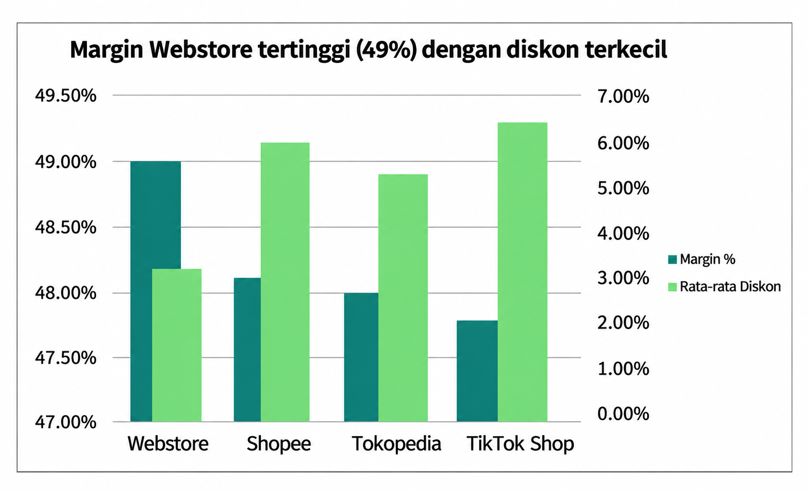
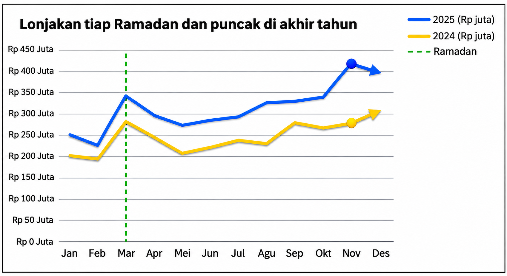
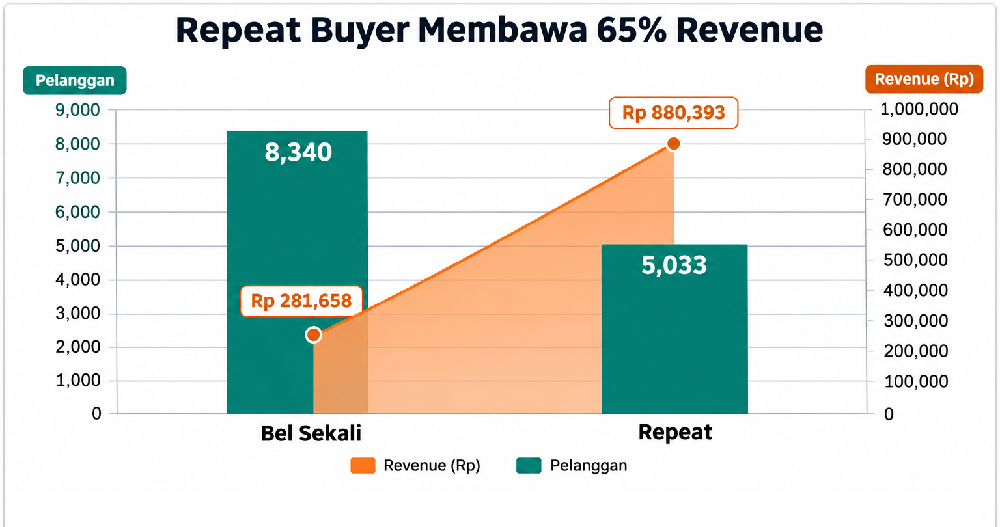
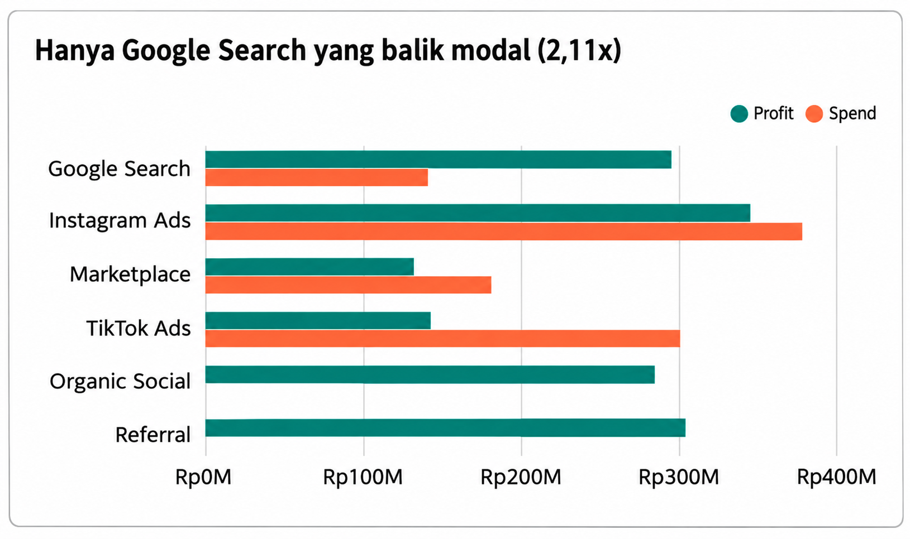
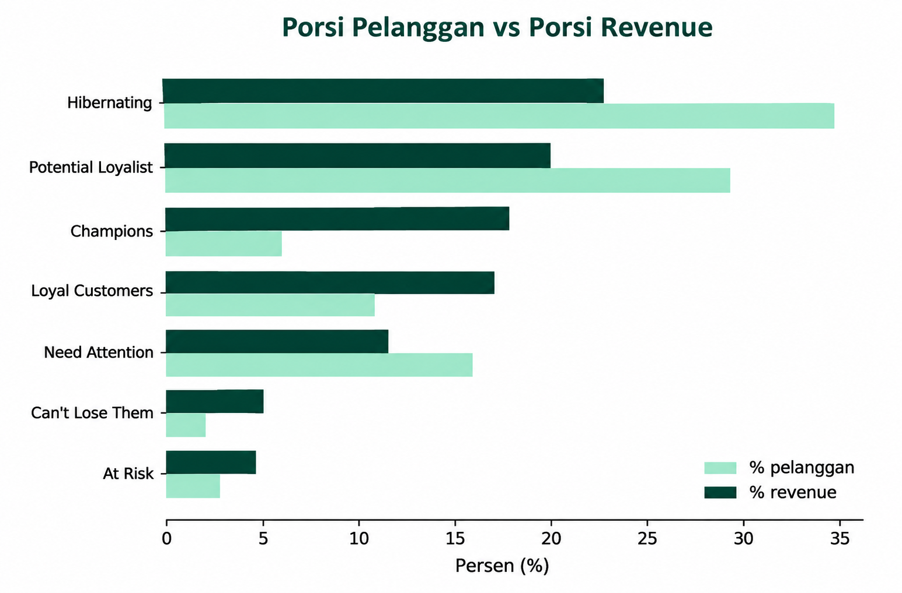
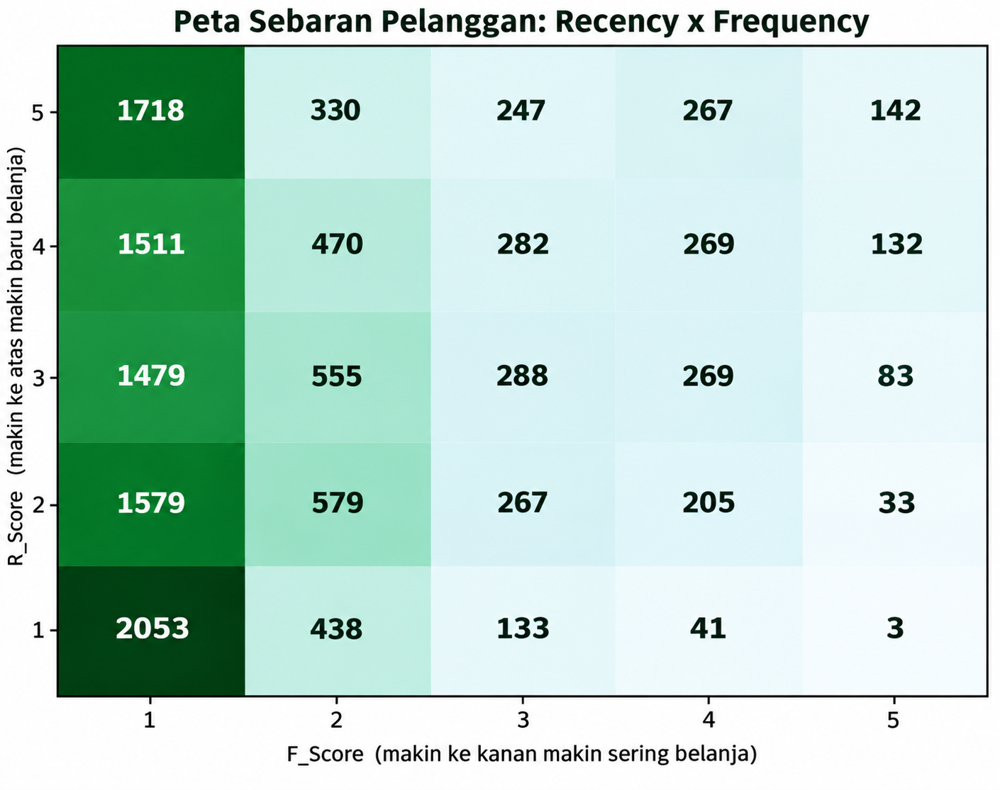
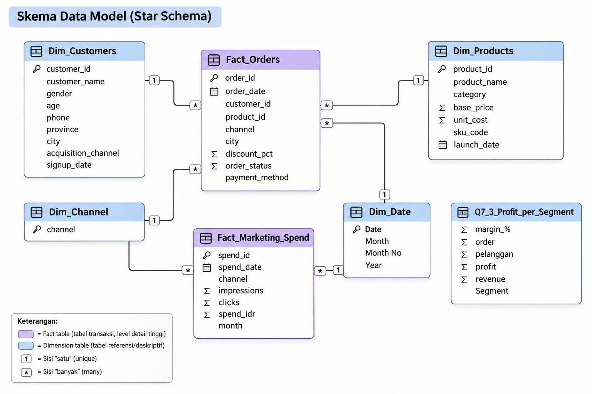
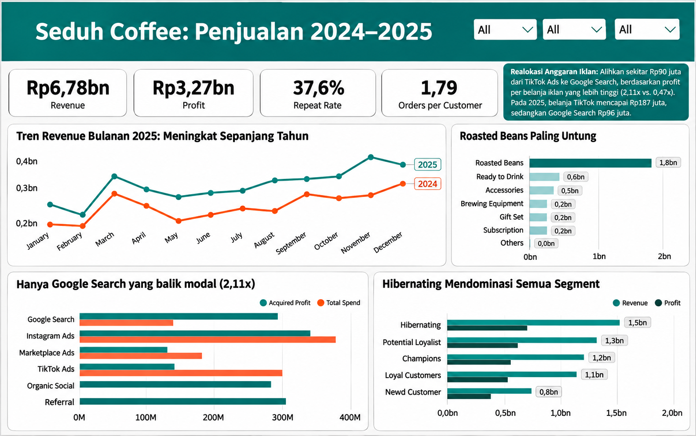
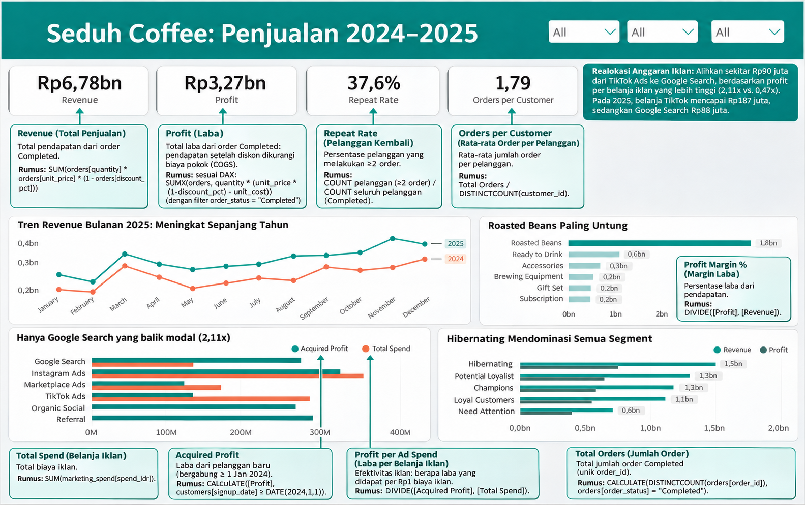

# seduh-coffee-sales-analysis | End-to-End Data Analysis (Python, SQL, Excel & Power BI)

## Gambaran Proyek

Evaluasi kinerja penjualan **Seduh Coffee** (merek kopi spesialti D2C Indonesia) sepanjang tahun 2024–2025 di 4 saluran penjualan (Webstore, Shopee, Tokopedia, dan TikTok Shop).

**Masalah Bisnis:**
*Revenue* 2025 tumbuh **+26,34% (Rp3,78 miliar)** dari Rp3,00 miliar di 2024, namun ditopang kenaikan anggaran iklan sebesar **63%**. Target tahun 2026 adalah **Rp5,0 miliar (+32%)** tanpa menaikkan budget iklan secara sebanding. Jika tren +26,34% bertahan, proyeksi 2026 hanya mencapai **Rp4,78 miliar** (kurang **Rp218 juta**). Analisis ini berfokus pada efisiensi iklan, batas diskon optimal, dan peningkatan transaksi berulang (*repeat order*).

**Alur Kerja (*Workflow*):**
1. **Data Cleaning (Jupyter - Python):** Membersihkan 4 *sheet* data mentah menjadi 4 file CSV bersih menggunakan `pandas`.
2. **Data Modeling (BigQuery - SQL):** Menggabungkan CSV bersih untuk membuat tabel rincian transaksi (`ENRICHED`) dan ringkasan pelanggan beserta alokasi iklan (`CUSTOMER_SUMMARY`).
3. **Exploratory & Pivot Analysis (Sheets & Excel):** Mengunduh tabel hasil SQL ke `.xlsx` untuk membuat *Pivot Table* & *Chart* (Q1–Q6).
4. **Segmentasi RFM (Google Colab - Python):** Memetakan 13.373 pelanggan aktif ke dalam 7 segmen RFM (Q7).
5. **Interactive Dashboard (Power BI):** Membangun relasi tabel (*Data Model*), rumus DAX, dan visualisasi interaktif.

**Link Penting:**
+ **Slide Portofolio:** [`Fadhlul_Ikram-Portofolio-Project-Data_Analyst.pdf`](Slide%20Portofolio/Fadhlul_Ikram-Portofolio-Project-Data_Analyst.pdf)
+ **Notebook Cleaning & RFM:** [`Seduh_Coffee_Data_Cleaning.ipynb`](Notebook%20Cleaning%20&%20RFM/Seduh_Coffee_Data_Cleaning.ipynb) | [`RFM_Segmentasi_Pelanggan.ipynb`](Notebook%20Cleaning%20&%20RFM/RFM_Segmentasi_Pelanggan.ipynb)
+ **Query SQL & Dataset:** [`final.sql`](Query%20SQL%20&%20Dataset/final.sql) | [`Seduh_Coffee-Final_Project.xlsx`](Query%20SQL%20&%20Dataset/Seduh_Coffee-Final_Project.xlsx)

## **Daftar Isi**
- [Data Cleaning & Persiapan Data](#data-cleaning--persiapan-data)
- [Hasil Visualisasi & Analisis (Q1–Q7)](#hasil-visualisasi--analisis-q1q7)
- [Dashboard & Data Modeling (Power BI)](#dashboard--data-modeling-power-bi)
- [Kesimpulan & Rekomendasi Bisnis](#kesimpulan--rekomendasi-bisnis)

---

## Data Cleaning & Persiapan Data

### 1. Pembersihan Data di Python (`pandas`)

| Tabel | Baris Awal → Akhir | Tindakan Pembersihan |
|---|---|---|
| **Orders** | 25.804 → 25.776 | Hapus 14 duplikat & 14 baris `quantity` <= 0, konversi 300 `order_date` teks, serta standarisasi nama `channel` (759 baris) dan `city` (520 baris). |
| **Customers** | 15.000 → 15.000 | Rapikan `customer_name` (*Title Case*), seragamkan 10.000 `phone` ke `08xxxxxxxxxx`, standarisasi `gender` (*Male/Female*), dan isi 380 `city` kosong menjadi `"Unknown"`. |
| **Products** | 50 → 50 | Seragamkan 9 variasi penulisan `category` menjadi 6 kategori baku, konversi tipe harga & tanggal. |
| **Marketing_Spend** | 96 → 96 | Validasi kelengkapan data (24 bulan x 4 channel tanpa duplikat) & konversi tipe data. |

Dari **25.776 pesanan bersih**, sebanyak **23.971 pesanan `Completed` (13.373 pelanggan unik)** dipakai untuk analisis *Revenue* dan *Profit* (1.038 `Returned` dan 767 `Cancelled` dipisahkan).

### 2. Pembuatan Tabel di BigQuery SQL
+ **Tabel `ENRICHED`**: Menggabungkan `orders` (`Completed` 2024–2025), `customers`, dan `products`, serta menghitung kolom `net_unit_price`, `revenue`, `cogs`, `profit`, dan `discount_idr`.
+ **Tabel `CUSTOMER_SUMMARY`**: Agregasi transaksi per pelanggan, klasifikasi `Beli Sekali` vs `Repeat`, dan alokasi biaya iklan tahunan per pelanggan menggunakan `COUNT(*) OVER (PARTITION BY signup_year, acquisition_channel)`.

---

## Hasil Visualisasi & Analisis (Q1–Q7)

### 1. Kategori Produk & Margin Channel (Q1–Q2)

<table>
  <tr>
    <td align="left" valign="top">
      <a href="images/chart_roasted_beans.png"></a>
    </td>
    <td align="right" valign="top">
      <a href="images/chart_margin_channel.png"></a>
    </td>
  </tr>
</table>

+ **Roasted Beans Paling Untung:** Menyumbang **48% revenue (Rp3,28 M)** dan **56% total profit** (*House Blend 500g* terjual 2.360 pcs). Sebaliknya, **Brewing Equipment** menyumbang 12% *revenue* (Rp839 juta) tapi hanya 7% *profit*.
+ **Margin Webstore Tertinggi (49,0%):** Empat *channel* memiliki margin berkisar 47,7%–49,0%. **Webstore** tertinggi karena rata-rata diskonnya terkecil (**3,3%** vs **6,4%** di TikTok Shop).

---

### 2. Tren Musiman & Repeat Buyer (Q3–Q4)

<table>
  <tr>
    <td align="left" valign="top">
      <a href="images/chart_monthly_trend.png"></a>
    </td>
    <td align="right" valign="top">
      <a href="images/chart_repeat_buyer.png"></a>
    </td>
  </tr>
</table>

+ **Lonjakan Ramadan & Akhir Tahun:** *Revenue* 2025 selalu di atas 2024 tiap bulannya. Titik terendah jatuh di bulan **Februari**, melonjak saat **Maret (Ramadan)**, dan mencapai puncak di akhir tahun (**November 2025: Rp419,8 juta**, di mana promo 11.11 naik 2,7–2,8x hari biasa).
+ **Repeat Buyer Membawa 65,4% Revenue:** Sebanyak **62,4% pelanggan (8.340 orang)** hanya belanja sekali, padahal **37,6% pelanggan *repeat*** menyumbang hampir dua pertiga total pendapatan.

---

### 3. Efisiensi Iklan & Evaluasi Diskon (Q5–Q6)

<a href="images/chart_google_search_roi.png"></a>

+ **Hanya Google Search yang Balik Modal (2,11x):** Berdasarkan kohort pelanggan 2024–2025, rasio *profit-to-spend* **Google Search mencapai 2,11x** (Profit Rp295 jt vs Spend Rp140 jt), sedangkan **TikTok Ads hanya 0,47x** (Profit Rp143 jt vs Spend Rp301 jt).
+ **Diskon >10% Menggerus Profit per Order:**

| Tingkat Diskon | Order | Avg Unit | Total Unit | Revenue (Rp Juta) | Profit (Rp Juta) | Avg Profit / Order | Margin % |
|---|---:|---:|---:|---:|---:|---:|---:|
| **0%** | 13.596 | 2,17 | 29.477 | 3.581 | 1.838 | Rp135.213 | 51,34% |
| **5%** | 2.563 | 2,53 | 6.478 | 764 | 374 | Rp145.991 | 48,99% |
| **10%** | 3.284 | 2,82 | 9.262 | 992 | 459 | Rp139.892 | 46,33% |
| **15%** | 2.740 | 3,03 | 8.311 | 873 | 379 | Rp138.413 | 43,45% |
| **20%** | 998 | 3,28 | 3.271 | 313 | 123 | Rp123.467 | 39,43% |
| **25%** | 790 | 3,55 | 2.807 | 258 | 92 | Rp115.881 | 35,42% |
| **Grand Total** | **23.971** | **2,49** | **59.606** | **6.780** | **3.266** | **Rp136.246** | **48,17%** |

  Diskon 25% menaikkan unit per pesanan (2,17 → 3,55), tetapi menurunkan profit per pesanan dari **Rp135 ribu menjadi Rp116 ribu**. Profit per pesanan paling optimal berada di kisaran diskon **5%–10%**.

---

### 4. Segmentasi Pelanggan RFM di Python (Q7)
Menggunakan titik acuan 1 Januari 2026 dengan pembagian skor 1–5 (kuintil untuk *Recency* & *Monetary*, serta aturan jumlah transaksi untuk *Frequency*):

<table>
  <tr>
    <td align="left" valign="top">
      <a href="images/rfm_pareto.png"></a>
    </td>
    <td align="right" valign="top">
      <a href="images/rfm_heatmap.png"></a>
    </td>
  </tr>
</table>

+ **Hibernating (34,8% pelanggan | Rp1,57 M revenue)** & **Potential Loyalist (30,1% pelanggan | Rp1,36 M revenue)** mendominasi 64,9% populasi pelanggan yang baru belanja 1–2 kali.
+ **Champions (6,0% pelanggan | Rp1,22 M revenue)** & **Loyal Customers (8,8% pelanggan | Rp1,17 M revenue)** menjadi kontributor paling efisien (14,8% pelanggan menyumbang 35,3% *revenue*).
+ **At Risk (400 orang)** & **Can't Lose Them (282 orang)** menyimpan *revenue* historis **Rp685 juta (10,1%)** yang rawan hilang jika tidak segera direaktivasi.

---

## Dashboard & Data Modeling (Power BI)

### 1. Skema Relasi Tabel (*Galaxy Schema*)

<a href="images/relat.png"></a>

+ **`orders` (Fact Table)** terhubung *Many-to-One* (`*:1`) ke **`costumers`** (`customer_id`), **`products`** (`product_id`), dan **`Dim_Date`** (`order_date`).
+ **`Dim_Date`** & **`Dim_Channel`** menjadi tabel dimensi jembatan antara transaksi pelanggan dan **`marketing_spend`**, sedangkan **`Q7 3 Profit_per_Segmen`** memuat hasil agregasi segmen RFM dari Python.

### 2. Tampilan Dashboard Power BI

<a href="images/sales-dashboard-2024–2025.png"></a>
+ **Revenue 2025 lebih tinggi di semua bulan dibanding 2024, puncak di akhir tahun.** Roasted Beans paling untung.
+ **Hanya Google Search** yang laba kotornya menutup biaya iklan (2,11x).
+ **Hibernating dan Potential Loyalist** mendominasi pelanggan, sehingga repeat order jadi prioritas.

### 3. DAX Measures

<a href="images/dashboard-infographic.png"></a>

```dax
// 1. METRIK UTAMA (REVENUE, PROFIT & MARGIN)
Revenue = 
CALCULATE(
    SUMX(orders, orders[quantity] * orders[unit_price] * (1 - orders[discount_pct])),
    orders[order_status] = "Completed"
)

Profit = 
CALCULATE(
    SUMX(
        orders,
        orders[quantity] * (orders[unit_price] * (1 - orders[discount_pct]) - RELATED(products[unit_cost]))
    ),
    orders[order_status] = "Completed"
)

Profit Margin % = DIVIDE([Profit], [Revenue])

// 2. METRIK PESANAN & PELANGGAN (REPEAT RATE)
Total Orders = 
CALCULATE(DISTINCTCOUNT(orders[order_id]), orders[order_status] = "Completed")

Orders per Customer = 
DIVIDE([Total Orders], DISTINCTCOUNT(costumers[customer_id]))

Repeat Rate = 
CALCULATE(
    DIVIDE(
        COUNTROWS(
            FILTER(
                VALUES(orders[customer_id]),
                CALCULATE(DISTINCTCOUNT(orders[order_id])) >= 2
            )
        ),
        DISTINCTCOUNT(orders[customer_id]),
        0
    ),
    orders[order_status] = "Completed"
)

// 3. METRIK EFISIENSI IKLAN (AD SPEND & POAS)
Total Spend = SUM(marketing_spend[spend_idr])

Acquired Profit = 
CALCULATE([Profit], costumers[signup_date] >= DATE(2024,1,1))

Profit per Ad Spend = DIVIDE([Acquired Profit], [Total Spend])

POAS = DIVIDE([Profit], [Total Spend])
```

# Kesimpulan & Rekomendasi Bisnis

### Kesimpulan Utama:
+ **Pertumbuhan +26,34% di 2025 masih bergantung pada lonjakan biaya iklan (+63%)**, di mana hanya Google Search yang mencatat profit kotor di atas biaya iklan (2,11x vs TikTok Ads 0,47x).
+ **Sebanyak 62,4% pelanggan hanya belanja sekali**, sementara profit terbesar terkonsentrasi pada kategori Roasted Beans (56% profit).

## Rekomendasi untuk Mencapai Target Rp5,0 Miliar di 2026:

**1. Dorong Order Kedua & Win-Back Pelanggan**

+ Berikan voucher pembelian kedua/paket bundling (berlaku 14–30 hari) untuk 4.029 Potential Loyalist (konversi 20%–30% berpotensi menambah revenue Rp182 juta – Rp274 juta), serta kirim pesan WhatsApp personal untuk mereaktivasi 682 pelanggan Can't Lose Them & At Risk (menjaga revenue historis Rp685 juta).

**2. Realokasi 30% Budget TikTok Ads ke Google Search**

+ Alihkan sekitar Rp90 juta anggaran iklan dari TikTok Ads ke Google Search secara bertahap tanpa menaikkan total budget pemasaran.

**3. Batasi Diskon Maksimal 10% & Siapkan Stok Musiman**

+ Terapkan batas diskon 5%–10%, fokuskan bundling pada Roasted Beans, pertahankan Champions & Loyal Customers lewat program reward non-diskon, serta siapkan kampanye sebelum puncak Maret (Ramadan) dan Oktober–Desember.
